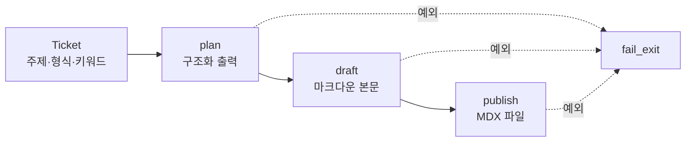

# kodding-lite

LangGraph로 만든 블로그 글 생성 파이프라인입니다. 주제 하나를 넣으면 **기획 → 초안 → 발행(MDX 파일)** 세 단계를 거쳐 바로 쓸 수 있는 글 파일이 나옵니다.

실제로 운영했던 9단계 멀티에이전트 블로그 파이프라인에서 핵심 뼈대만 떼어낸 버전입니다. 원본은 열흘 동안 17편을 발행했고, 마지막 5회는 사람 개입 없이 무인으로 발행됐습니다.



## 빠른 시작

Python 3.10 이상이 필요합니다.

```bash
git clone <this-repo> && cd kodding-lite
python -m venv .venv
# Windows: .venv\Scripts\activate   /   macOS·Linux: source .venv/bin/activate
pip install -e .

cp .env.example .env          # GOOGLE_API_KEY만 넣으면 됩니다
python -m kodding_lite --topic "Claude Code와 Cursor 실무 비교" \
    --category "비교 리뷰" --keywords claude-code,cursor
```

결과는 `output/posts/<slug>.mdx`에 생깁니다. 프론트매터가 붙어 있어 Next.js·Astro 같은 MDX 블로그의 content 폴더에 넣으면 그대로 글이 됩니다. 기본값이 `draft: true`이니 검토한 뒤 `false`로 바꿔 공개하세요.

## 설계에서 신경 쓴 부분

**단계 간 통신은 스키마로 고정합니다.** 에이전트끼리 자유 텍스트를 주고받지 않습니다. `Ticket`과 `Plan`을 Pydantic 모델로 정의하고, LLM 출력은 `with_structured_output`으로 이 스키마에 맞춰 받습니다. 파싱에 실패하면 한 번만 다시 요청합니다.

**실패해도 그래프가 죽지 않습니다.** 모든 노드를 `_guard`로 감싸서 예외를 `state["error"]`와 `state["failed_node"]`로 바꾸고, 조건부 엣지가 `fail_exit`로 보냅니다. 최종 state만 보면 어느 단계에서 왜 실패했는지 알 수 있습니다.

**모델 라우팅은 한 곳에서만 정합니다.** `models.py`의 `ROUTING` 표가 유일한 정의입니다. 노드 코드에는 모델명이 없습니다. env로 노드별 모델을 바꿀 수 있습니다.

```bash
MODEL_DRAFT=claude-sonnet-4-6 python -m kodding_lite ...   # 초안만 Claude로
```

**정관(charter)으로 글의 기준을 통일합니다.** `charter.example.md`의 문체·금지 규칙이 모든 노드의 시스템 프롬프트에 들어갑니다. 내 블로그에 맞게 `charter.md`로 복사해서 고치면 그쪽이 우선 적용됩니다. Claude로 라우팅된 노드는 정관을 프롬프트 캐시 블록으로 분리해서 반복 호출 비용을 줄입니다.

**모델이 규칙을 어겨도 결과물은 깨지지 않게 합니다.** 프롬프트로 H1 제목을 금지해도 모델은 가끔 씁니다. `publish` 노드가 선두 H1을 지우고, MDX 빌드를 깨뜨리는 HTML 주석(`<!-- -->`)을 MDX 주석으로 바꾸고, 한글 태그는 건너뜁니다. slug가 겹치면 `-2` 접미사를 붙이고 덮어쓰지 않습니다.

**429·5xx는 지수 백오프로 3회 재시도합니다.**

## 테스트

실제 API 없이 페이크 모델로 그래프 전체를 검증합니다.

```bash
pip install -e ".[dev]"
pytest
```

## 이 버전에 없는 것

원본 파이프라인에는 리서치(웹 검색과 공식 출처 수집), 퇴고, QA 체크리스트와 수정 루프, RSS 기반 주제 기획, GitHub Actions 스케줄 발행, Slack·LangSmith 관측이 더 있습니다. 전체 구조와 운영하면서 겪은 문제는 블로그 글로 정리하고 있습니다.

- 글: velog 시리즈 준비 중
- 전체 버전 출시 알림 받기: https://docs.google.com/forms/d/e/1FAIpQLSe2oi5fH5gc8DoCTdHHmav_-rLgEP3_qUH7Sf6-qnt7pxeUjw/viewform

## 라이선스

MIT
